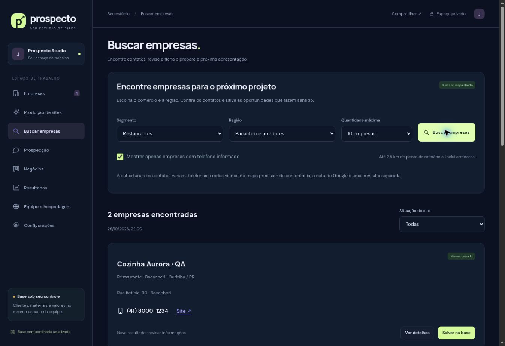

# Prospecto — estúdio de sites para negócios locais

Projeto pessoal de Engenharia de Software para organizar oportunidades comerciais, preparar páginas de apresentação e acompanhar propostas em equipe. Em desenvolvimento, com assistência de IA na implementação.



## O que o projeto demonstra

- Cadastro e qualificação de empresas, materiais e fontes de pesquisa.
- Editor de HTML, CSS e JavaScript com rascunhos, histórico e prévia isolada.
- Briefing, catálogo, preços, prompts editáveis e preparação de propostas.
- Funil comercial, registros manuais de custos e recebimentos e lixeira recuperável.
- API com controle de acesso, banco D1, arquivos R2 e integração MCP.
- Consulta de empresas via OpenStreetMap e preparação de prompts para o Lovable.

## Para recrutadores

O [mapa do código](docs/ARQUITETURA.md) explica as partes do sistema. Os testes em `tests/` cobrem regras, sincronização, permissões, editor e APIs. O [escopo e os limites](docs/LIMITACOES.md) deixam claro o que está implementado e o que continua em desenvolvimento.

Este repositório contém código e exemplos. Não contém o banco de clientes, arquivos de clientes, credenciais, configuração de publicação ou acesso à operação privada. Alterações aqui não são publicadas automaticamente no sistema em uso.

## Executar localmente

Requisitos: Node.js 22.13 ou superior e pnpm 11.25.0. Use um gerenciador de versões para instalar o Node e o pnpm na versão indicada em `package.json`.

```bash
pnpm install --frozen-lockfile
cp .env.example .dev.vars
pnpm dev
```

Abra o endereço local informado pelo servidor. O ambiente local usa a identidade fictícia `seedy@sites.test`; a configuração de exemplo atribui a ela a administração apenas deste ambiente. O login local é simulado pelo plugin de desenvolvimento, sem acesso à conta ou aos dados do responsável pelo projeto.

O arquivo `.openai/hosting.json` desta cópia declara somente os nomes de bindings usados na emulação. Não contém o identificador do Site privado. Não publique esse ambiente de desenvolvimento como serviço real. Hospedar fora do Sites exige adaptar e revisar autenticação, banco, arquivos e implantação.

## Verificações

```bash
pnpm test
pnpm typecheck
pnpm build
```

Depois do build, `pnpm test:integration` executa a suíte de APIs e MCP com D1/R2 temporários. Esses testes não utilizam o banco de produção. Consulte [Operação e testes](docs/OPERACAO.md) para os cenários adicionais.

## Tecnologias

JavaScript em módulos no frontend, TypeScript no servidor, Vinext/React para rotas, Cloudflare Workers, D1, R2, Drizzle, Vite e Miniflare. A interface principal fica em `studio.html` e `public/`; os componentes React do starter não representam toda a interface do produto.

## Contribuir

Leia [CONTRIBUTING.md](CONTRIBUTING.md). Faça um fork, trabalhe em uma branch e abra um pull request. O responsável revisa as propostas; contribuir no código não concede acesso ao painel privado ou à hospedagem.

## Dados de exemplo e licença

O lote em `data/pilot-curitiba.json` usa empresas inventadas nesta edição de portfólio. Domínios `example.com` e e-mails `.test` são exemplos; não são contatos comerciais. Pesquisa externa real depende de ação explícita e de conferir as condições da fonte. Não há disparo automático de mensagens, agente permanente de vendas ou promessa de receita.

Código próprio disponibilizado sob a licença MIT. Dependências e arquivos de terceiros mantêm suas respectivas licenças; os avisos estão junto dos arquivos em `vendor/`, `public/licenses/` e `scripts/vite/`.
